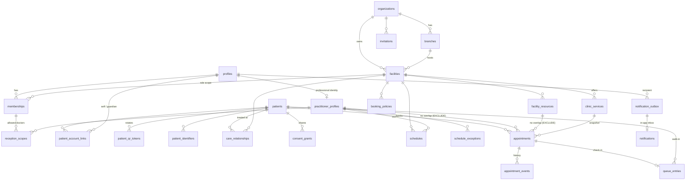

# المعمارية والقرارات

> الحالة: المراحل 0–3 منفذة ومختبرة محلياً (انظر [TRACEABILITY.md](TRACEABILITY.md)). هذا نظام قيد البناء وليس معتمداً للاستخدام الطبي.

## 1. الصورة العامة

```
┌──────────────────────────┐   ┌──────────────────────────────┐
│ Patient Experience (web) │   │ Professional Web Portal      │
│ /patient  (mobile-first) │   │ /workspace/* · /platform-admin│
└────────────┬─────────────┘   └──────────────┬───────────────┘
             │  supabase-js + publishable key + user JWT          
             ▼                                                    
┌──────────────────────────────────────────────────────────────┐
│ Supabase Cloud                                                │
│  Auth ── PostgREST ── RPC (SECURITY DEFINER, explicit checks) │
│  PostgreSQL: RLS on every exposed table, exclusion constraints│
│  Realtime (refresh signal only) · Storage (Phase 3)           │
│  Edge Function: notifications-worker  ◄── pg_cron (+ pg_net)  │
└──────────────────────────────────────────────────────────────┘
```

* **تطبيق ويب واحد** (`apps/web`) يحتوي التجربتين بمسارين منفصلين؛ قواعد العمل كلها في قاعدة البيانات فلا تتكرر بين الواجهات. تطبيق المريض للهاتف (`apps/mobile`، Expo — انظر docs/MOBILE.md) يعيد استخدام `packages/shared` (الأنواع، التحقق، التنسيقات، رسائل الأخطاء) ونفس الـRPC.
* **لا يوجد خادم مستقل**: "الخلفية" = وظائف PostgreSQL (RPC ذرية) + RLS + Edge Functions قصيرة التشغيل.

## 2. القرارات (ADR مختصر)

| # | القرار | السبب |
|---|--------|-------|
| D1 | React + TypeScript + Vite للويب، monorepo بـ pnpm | مشروع جديد؛ مطابق للافتراض المقترح في التوصيف |
| D2 | كل عملية متعددة الخطوات = دالة PostgreSQL واحدة (RPC) | المعاملة الذرية حقيقية؛ سلسلة طلبات REST ليست معاملة |
| D3 | منع التداخل بـ `EXCLUDE USING gist (practitioner_id =, blocked_period &&)` جزئي على الحالات الحاجزة | يضمن الاتساق تحت التزامن، ويغطي البدايات المختلفة والفروع المختلفة |
| D4 | الفترات `[start, end)` + `blocked_period` يشمل الفاصل الزمني (buffer) | 18:30 يبدأ مباشرة بعد 18:00–18:30 |
| D5 | انتهاء مهلة التأكيد = تحديث ذري للحالة إلى `expired` (كسول داخل مسار الحجز + pg_cron كل دقيقة) | لا اعتماد على `now()` في شرط فهرس؛ التأكيد المتأخر يُرفض |
| D6 | `idempotency_key` إلزامي وفريد لكل (منشئ، مفتاح) | إعادة المحاولة أو الضغط المزدوج لا ينشئ تكراراً |
| D7 | المريض (السجل الطبي) منفصل عن الحساب؛ `patient_account_links` (self/guardian) | يمكن وجود مريض بلا حساب، وربطه لاحقاً بتحقق |
| D8 | الهاتف ليس هوية؛ لا دمج تلقائي؛ الدمج مدقق ويعيد توجيه كل FK المرجعي ديناميكياً من الكتالوج | يحفظ التاريخ ويغطي الجداول المستقبلية تلقائياً |
| D9 | رمز QR عشوائي قابل للتدوير؛ يُخزن خاماً لعرضه للمريض/الطباعة لكن لا يقرؤه إلا المريض المرتبط (منح أعمدة) | QR وسيلة تعريف لا تصريح؛ البحث به يحتاج موظفاً مخولاً + حد معدل + تدقيق |
| D10 | العضوية = (مستخدم × منظمة/منشأة × دور)؛ السكرتير مقيد بأطباء محددين صراحةً (`reception_scopes`) | أقل صلاحية؛ لا حساب مشترك |
| D11 | السوبر أدمن بلا وصول ضمني لبيانات المرضى؛ MFA (aal2) مطلوب افتراضياً للأدوار الإدارية (`platform_settings.require_admin_mfa`) | §3، §13 |
| D12 | Transactional outbox + عامل قصير التشغيل؛ القناة الافتراضية in-app حتى ربط مزود push | لا إشعار قبل التثبيت؛ لا ادعاء بإرسال غير مهيأ |
| D13 | جلسة Auth في `sessionStorage` لا `localStorage` | حواسيب العيادات مشتركة؛ اختيار مساحة العمل تفضيل واجهة فقط والتفويض خادمي |
| D14 | المال `bigint` بوحدات صحيحة، IQD افتراضياً | لا floating point |
| D15 | خط IBM Plex Sans Arabic (OFL) مستضاف ذاتياً عبر fontsource | ترخيص مفتوح، بلا طلبات لطرف ثالث |

## 3. الافتراضات (قابلة للمراجعة)

* النسخة الأولى: موعد فردي (سعة 1) للطبيب؛ مورد واحد (غرفة/محطة سحب) بسعة 1 عبر قيد استبعاد ثانٍ. السعات المتعددة لاحقاً بجدول حجز موارد.
* المنطقة الزمنية الافتراضية `Asia/Baghdad`؛ كل فرع يحمل منطقته، والجداول بالتوقيت المحلي للفرع.
* الأسبوع يُعرض من السبت؛ الجمعة عطلة في البيانات التجريبية فقط.
* السكرتير يرى أوقاتاً شاغرة قريبة (لا تنطبق عليه مهلة الحد الأدنى للمريض) لكن ضمن ساعات العمل فقط.
* الدفع والإيصالات خارج نطاق المراحل 0–2 (المرحلة 6)، لذا لا يظهر زر إيصال وهمي.

## 4. وحدات قاعدة البيانات

| الوحدة | migrations | الجداول الرئيسية |
|--------|-----------|------------------|
| foundation | 0001 | `platform_settings`, `access_audit`, helpers (`private.*`) |
| identity / organizations | 0002, 0004 | `profiles`, `platform_admins`, `organizations`, `branches`, `facilities`, `practitioner_profiles`, `memberships`, `reception_scopes`, `invitations`, `cities`, `specialties` |
| patients | 0003, 0007 | `patients`, `patient_account_links`, `patient_identifiers`, `patient_qr_tokens`, `care_relationships`, `consent_grants` |
| notifications | 0005, 0009 | `notification_outbox`, `notifications` |
| clinical | 0010 | `encounters`, `clinical_notes` (مقفلة بعد الاعتماد بـtrigger)، `allergies`, `patient_reported_medications`, `clinical_tasks` |
| prescriptions | 0011 | `medication_catalog`, `prescriptions`, `prescription_versions` (snapshot + verify_token)، `prescription_items` (مقفلة بعد الاعتماد)، `prescription_dispatches`, `prescription_events` |
| laboratory | 0012 | `lab_test_catalog`, `lab_orders`, `lab_order_items`, `specimens`, `lab_results` (إصدارات، المنشور مقفل) |
| read models | 0013 | `patient_journey`, `my_prescriptions`, `my_lab_orders`, `encounter_orders`, `my_clinical_tasks`, `lab_choices` |
| scheduling | 0006, 0008 | `clinic_services`, `facility_resources`, `booking_policies`, `schedules`, `schedule_exceptions`, `appointments`, `appointment_events`, `queue_entries`, `delay_notices` |

المخطط `private` غير معروض عبر Data API ويحتوي دوال التفويض. كل دالة `SECURITY DEFINER` تثبت `search_path = ''` وتُسحب منها صلاحية التنفيذ العامة ثم تُمنح صراحة.

## 5. ERD (المنفذ حالياً)



المرحلة 3 أضافت: `encounters`, `clinical_notes`, `allergies`, `clinical_tasks`, `medication_catalog`, `prescriptions`, `prescription_versions`, `prescription_items`, `prescription_dispatches`, `prescription_events`, `lab_test_catalog`, `lab_orders`, `lab_order_items`, `specimens`, `lab_results` (الإحالات ممثلة بـ`prescription_dispatches` و`lab_orders.source='referral'`).

الجداول المخططة للمراحل التالية: `pharmacy_products`, `inventory_batches`, `stock_movements`, `stock_reservations`, `dispensing_records`, `attachments`, `invoices`, `payments`, `refunds`, `expenses`, `medication_plans`, `reminder_jobs`, `print_jobs`.

## 6. عقود API (RPC)

كل الأخطاء التطبيقية: `errcode P0001`، `message = 'app:<code>'` (خريطة الرسائل العربية في `packages/shared/src/errors.ts`).

### عامة (anon + authenticated)
| الدالة | الوصف |
|--------|-------|
| `search_providers(p_kind, p_query, p_specialty_id, p_city_id, p_lat, p_lng, p_max_km, p_limit)` | أطباء/مختبرات منشورة، مسافة haversine من إحداثيات الفرع الفعلية |
| `get_provider_profile(p_facility_id, p_practitioner_id)` | ملف عام + خدمات + ساعات + سياسة |
| `get_available_slots(p_facility_id, p_practitioner_id, p_service_id, p_from, p_to, p_for_staff)` | أوقات محسوبة في الخادم (≤ 31 يوماً) |

### المريض
`register_self_patient`, `my_appointments`, `book_appointment(... p_source app|web)`, `change_appointment_status(id, 'cancelled', reason)`, `reschedule_appointment`, `my_patient_card`, `rotate_patient_qr`, `create_account_link_code`, `grant_consent`, `revoke_consent`, `my_queue_status`.

### الاستقبال / الطبيب
`reception_practitioners`, `facility_day_board`, `facility_queue`, `reception_quick_book` (اسم فقط أو موجود؛ وقت أو قائمة انتظار)، `book_appointment(... 'reception')`, `change_appointment_status` (confirm/reject/check-in/no-show/fulfil/cancel مع تحقق الانتقال و`p_expected_version`)، `reschedule_appointment`, `assign_walk_in_slot`, `update_queue_entry`, `post_delay_notice`, `lookup_patients` (حد معدل + تدقيق + إخفاء الهاتف)، `attach_patient_to_facility`, `create_provisional_patient`, `issue_patient_card`, `link_patient_with_code`, `merge_patients` (مدير منشأة).

### إعداد الجدول
`set_weekly_schedule`, `add_schedule_exception`, `upsert_clinic_service`, `set_booking_policy`.

### الإدارة
`my_workspaces`, `my_access_summary`, `admin_create_organization|branch|facility`, `admin_set_entity_status` (سبب إلزامي)، `admin_set_account_status`, `admin_upsert_practitioner`, `create_invitation` (رمز يظهر مرة، صلاحية ≤ 14 يوماً)، `revoke_invitation`, `accept_invitation` (البريد يجب أن يطابق)، `admin_grant_membership`, `set_membership_status`, `set_reception_scope`, `facility_members`, `platform_overview`, `admin_retry_dead_notification`.

### الجلسة الطبية (الطبيب المؤلف فقط)
`start_encounter(queue_entry, identity_verified)`, `encounter_context`, `save_clinical_note_draft(…, expected_version)`, `sign_clinical_note`, `amend_clinical_note(…, reason)`, `set_encounter_status`, `add_allergy`, `encounter_orders`, `my_clinical_tasks`, `complete_clinical_task`.

### الوصفات
`search_medications`, `save_prescription_draft(… idempotency)`, `approve_prescription(id, send_to_pharmacy?, revision_reason?)`, `revise_prescription`, `cancel_prescription(reason)`, `record_prescription_print`, `prescription_document`, `pharmacy_choices`, `verify_prescription(token)` (عام، بلا بيانات المريض)، الصيدلية: `pharmacy_inbox`, `pharmacy_prescription`, `pharmacy_mark_received`. المريض: `my_prescriptions`.

### المختبر
`lab_choices`, `order_lab_tests(… idempotency)`, `lab_register_direct`, `lab_check_in`, `collect_specimen`, `reject_specimen(reason)`, `save_lab_result_draft` (فني/معتمد)، `release_lab_results(order, items[])` (معتمد فقط، جزئي)، `correct_lab_result(…, reason)`, `lab_worklist`, `lab_order_detail` (المسودات للمختبر فقط)، المريض: `my_lab_orders`, `patient_journey`.

### العامل (service role فقط)
`outbox_claim(p_limit, p_lease_seconds)`, `outbox_complete(...)`, `expire_pending_appointments()`.
