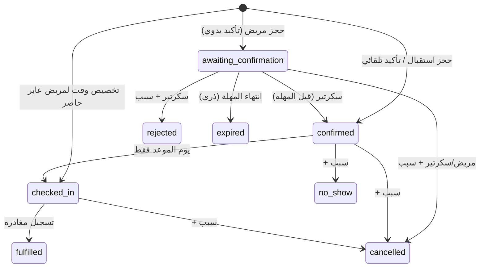

# حالات الانتقال

## الموعد (`appointment_status`)

* الحالات الحاجزة للوقت: `awaiting_confirmation`, `confirmed`, `checked_in`, `fulfilled` (عمود مولد `holds_slot`).
* `awaiting_confirmation` يحجز الفترة فعلاً؛ مهلته = `min(now + confirmation_timeout, start)` وتظهر للمريض.
* التأكيد بعد المهلة يعيد `expired` ولا يؤكد؛ وأي تأكيد لاحق لموعد `expired` يرفض بـ `invalid_transition`.
* إعادة الجدولة = إلغاء القديم + إدراج الجديد في معاملة واحدة؛ عند التعارض تُلغى المعاملة كلها ويبقى القديم كما هو.
* كل انتقال يُسجل في `appointment_events` (من، إلى، المنفذ، السبب).

## الطابور (`queue_status`) — منفصل عن الموعد
`waiting → called → in_session → done` و`waiting|called → left|cancelled`.
الترتيب: الأولوية (بسبب مسجل) ثم وقت الموعد أو وقت الوصول للعابر. التقدير يُعرض كتقدير وليس وعداً، ويضيف آخر إشعار تأخير.

## صندوق الإشعارات (`outbox_status`)
`pending → processing → sent` ؛ عند الفشل `failed` مع backoff أُسّي (حد ساعة) ثم `dead` بعد `max_attempts` لمراجعة المشغل. الـlease المنتهي يعاد التقاطه؛ الإكمال idempotent.

## الجلسة الطبية (المرحلة 3 — مخطط)
`not_started → in_progress → awaiting_results → ready_for_review → completed → closed`، مستقلة عن الموعد والطابور، وبدايتها بضغط الطبيب فقط.
